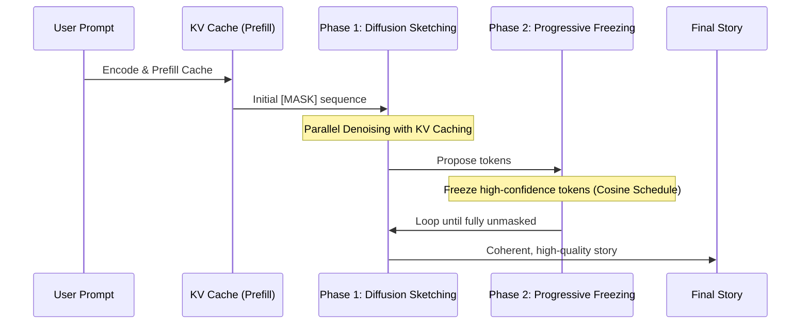
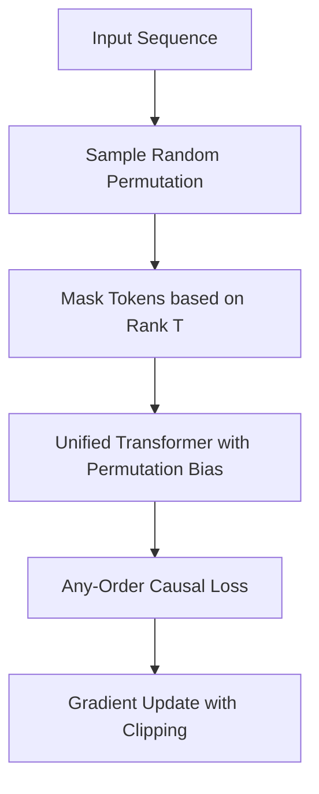

# Eso-LM: Unified Any-Order Language Model

A high-performance, faithful implementation of the **Eso-LM (B)** architecture as described in the paper: *"Esoteric Language Models (Eso-LMs): Fusing Autoregressive and Masked Diffusion Models"* (arXiv:2506.01928).


## Overview

This implementation utilizes a **Unified Denoising Transformer** that bridges the gap between Autoregressive (AR) and Masked Diffusion (MDM) through a single, shared attention mechanism. Unlike standard hybrid models, this version uses a **Unified Permutation Objective** (Any-Order Causal Masking) to train the model.

### Key Innovations:
- **Unified Permutation Training**: The model is trained on random permutations of tokens, allowing it to function as both a sequential and parallel generator.
- **Any-Order (AO) Causal Masking**: A sophisticated attention mechanism where tokens can see all unmasked context plus any tokens that appear "earlier" in the current random permutation.
- **Exact KV Caching**: Full support for Key-Value caching in both the diffusion sketching phase and the sequential polishing phase, drastically reducing inference latency.
- **Progressive Freezing (Cosine Scheduling)**: During inference, the model uses a cosine-weighted confidence threshold to decide which tokens to "lock in" at each diffusion step.
- **Natural Order Curriculum**: Training includes a 30% curriculum of "natural order" (standard AR) to stabilize grammar and long-range coherence.

### Generation Workflow


## Project Structure

- `train_esolm.py`: Unified training script using Any-Order Causal masking and BPE tokenization.
- `inference_esolm.py`: Optimized inference script with KV-cached two-phase generation.
- `esolm_faithful_roadmap.ipynb`: Research and prototyping notebook.

## Current Configuration (VRAM Optimized)

| Parameter | Value | Description |
| :--- | :--- | :--- |
| **Model Size** | ~33.6M | 8 Layers, 8 Heads, 512 Dimension |
| **Vocab** | 8,000 | BPE Tokenizer (SentencePiece) |
| **Batch Size** | 16 | Highly stable training for 8GB VRAM |
| **Steps** | 25,000 | Optimized convergence cycle |
| **Sequence Len** | 128 | Context window for stories |

## Training Logic
The model optimizes the **Negative Evidence Lower Bound (NELBO)** through a unified path:


## Setup & Usage

1. **Install Dependencies**:
   ```bash
   pip install torch sentencepiece datasets tqdm matplotlib
   ```

2. **Run Training**:
   ```bash
   python train_esolm.py
   ```

3. **Interactive Inference**:
   ```bash
   python inference_esolm.py
   ```

## References

- Eldan, R., & Li, Y. (2023). [TinyStories: How Small Can Language Models Be and Still Speak Coherent English?](https://arxiv.org/abs/2305.07759)
- [Esoteric Language Models (Eso-LMs)](https://arxiv.org/abs/2506.01928)
