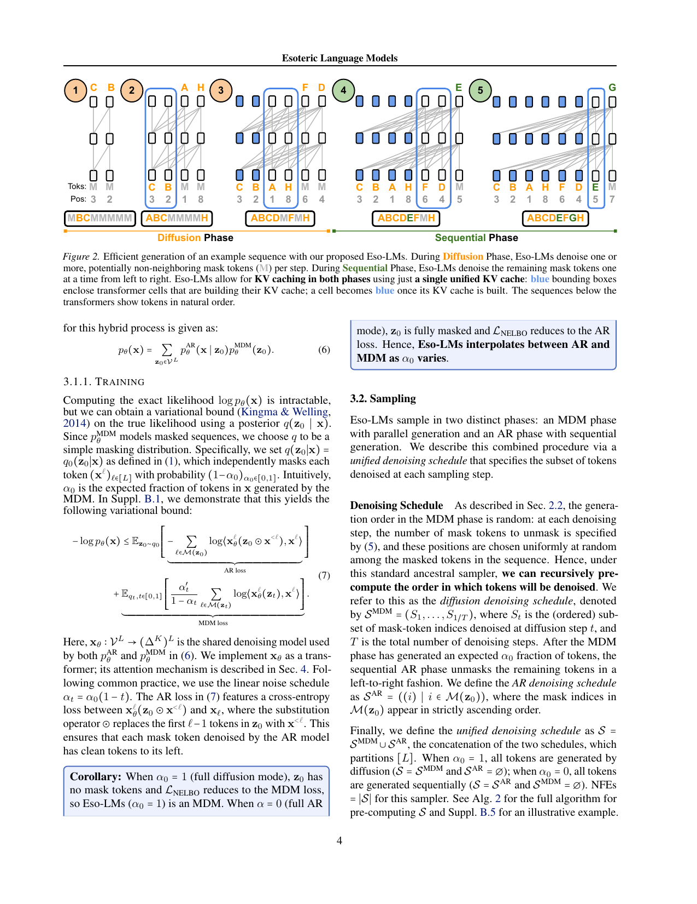
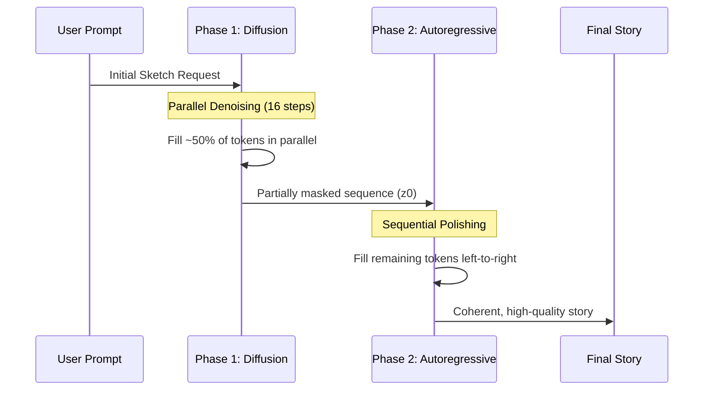
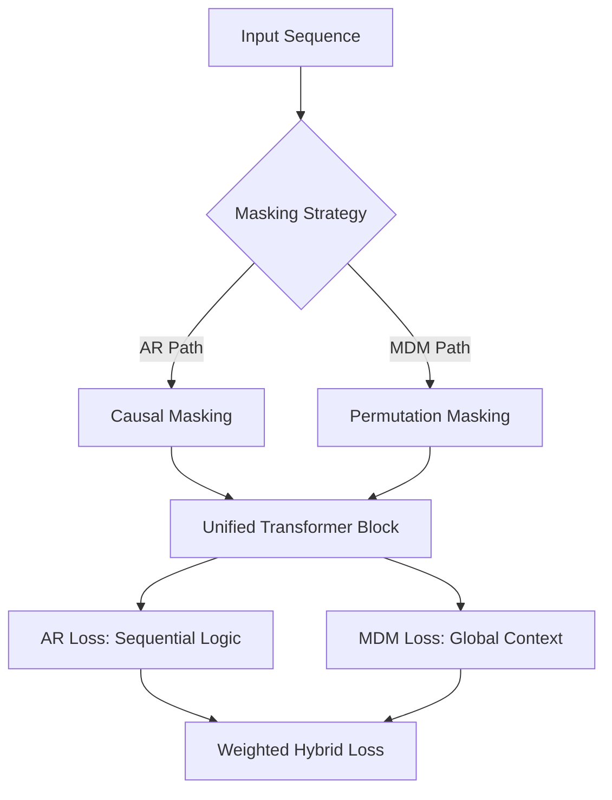

# Eso-LM: Esoteric Language Model (Faithful Implementation)

A 100% faithful implementation of the **Eso-LM (B)** architecture as described in the paper: *"Esoteric Language Models (Eso-LMs): Fusing Autoregressive and Masked Diffusion Models"* (arXiv:2506.01928).



## Overview

Eso-LM is a hybrid generative model that bridges the gap between **Autoregressive (AR)** and **Masked Diffusion (MDM)** models. It utilizes a single transformer architecture to perform both parallel sketching and sequential polishing.

### Key Innovations:
- **Hybrid Training Objective**: Combines causal AR loss and permutation-based MDM loss ($\kappa=0.5$).
- **Any-Order (AO) Formulation**: Generalizes the training objective to allow for arbitrary token denoising orders.
- **Two-Phase Generation**: 
  1. **Phase 1 (Diffusion)**: Parallel generation of tokens to "sketch" the scene (16-32 steps).
  2. **Phase 2 (Autoregressive)**: Sequential left-to-right generation to "polish" grammar and coherence.
- **Unified Attention Mechanism**: Uses custom `attn_bias` matrices to support both causal and non-causal masking in the same weights.

### Generation Workflow


## Project Structure

- `train_esolm.py`: High-performance training script with Mixed Precision (AMP), Cosine Decay, and Hybrid Loss tracking.
- `inference_esolm.py`: Two-phase generation script for interactive story completion.
- `esolm_faithful_roadmap.ipynb`: Research and prototyping notebook.

## Current Configuration (Overnight Behemoth)

| Parameter | Value | Description |
| :--- | :--- | :--- |
| **Model Size** | ~96M | 12 Layers, 12 Heads, 768 Dimension |
| **Vocab** | 8,000 | BPE Tokenizer (SentencePiece) |
| **Batch Size** | 64 | Optimized for RTX 4060 (8GB VRAM) |
| **Steps** | 50,000 | Deep training for perfect coherence |
| **Sequence Len** | 128 | Context window for stories |

## Training Progress Tracking

The model tracks two distinct losses:
1. **AR Loss**: Measures grammatical correctness and sequential logic.
2. **MDM Loss**: Measures the ability to fill in blanks and understand global context.

Graphs are automatically saved to `loss_plot.png` after every training run.

### Hybrid Training Logic


## Setup & Usage

1. **Install Dependencies**:
   ```bash
   pip install torch sentencepiece datasets tqdm matplotlib
   ```

2. **Run Training**:
   ```bash
   python train_esolm.py
   ```

3. **Interactive Inference**:
   ```bash
   python inference_esolm.py
   ```

## References

- Eldan, R., & Li, Y. (2023). [TinyStories: How Small Can Language Models Be and Still Speak Coherent English?](https://arxiv.org/abs/2305.07759)
- [Esoteric Language Models (Eso-LMs)](https://arxiv.org/abs/2506.01928)
