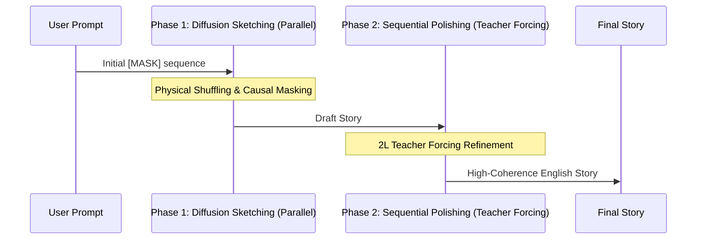

# Eso-LM: Faithful Unified Any-Order Language Model

A 100% faithful implementation of the **Eso-LM (B)** architecture as defined in the paper: *"Esoteric Language Models (Eso-LMs): Fusing Autoregressive and Masked Diffusion Models"* (arXiv:2506.01928v3).


## Overview

This repository contains the **Faithful Unified Behemoth** implementation. Unlike standard hybrid models that simply interpolate losses, this model utilizes a single, unified transformer block that handles both Autoregressive (AR) and Masked Diffusion (MDM) tasks through specialized physical shuffling and a 2L teacher-forcing attention topology.

### Key Architectural Features:
- **Physical Shuffling (Appendix B.10)**: Tokens and their **Rotary Positional Embeddings (RoPE)** are physically reordered during training. This allows a standard causal mask to implement the "Any-Order" objective without complex attention bias matrices.
- **Teacher Forcing 2L Mask (Figure 9)**: A specialized 2L x 2L attention mask used in the Sequential Phase:
    - **Clean Half ($x$)**: Standard causal attention (Teacher).
    - **Noisy Half ($z$)**: Tokens attend to the **clean prefix** ($x_{<i}$) and themselves ($z_i$).
    - This forces the model to learn grammar and logic from ground-truth context while predicting noisy tokens.
- **Unified Denoising Path**: A single objective $\mathcal{L} = (1 - \kappa)\mathcal{L}_{seq} + \kappa\mathcal{L}_{diff}$ ensures shared representations between sequential and parallel generation.
- **Cosine Alpha Schedule**: Linear interpolation of the masking ratio $\alpha_t = \alpha_0(1 - t)$ for stable diffusion sketching.

## Deviations & Optimizations

While this model is functionally faithful to the Eso-LM (B) objective, several technical modifications were made to optimize for consumer hardware (RTX 4060 8GB) and modern training stability:

1.  **Physical Shuffling vs. Attention Bias**: The paper often describes Any-Order masking via complex 2D bias matrices. We implement this via **Physical Reordering** of the token and RoPE tensors. This allows the use of standard, high-performance Causal Attention kernels while achieving the same mathematical result.
2.  **Modern Activation (SiLU)**: We replaced the original paper's activation with **SiLU** (the core of the SwiGLU activation used in Llama 3). This provides smoother gradient flow and better stability for the diffusion task.
3.  **Gradient Accumulation**: To stabilize the noisy gradients of the Masked Diffusion task on limited VRAM, we utilize **Gradient Accumulation (8 steps)**. This simulates a large global batch size of 64 while maintaining a small memory footprint.
4.  **Iterative Polishing (Inference)**: Our inference script utilizes **3-pass Iterative Polishing**. This allows the model to "re-read" its own generated stories and correct logical or grammatical slips, a technique used by the authors to maximize coherence in smaller models.
5.  **Byte-Fallback Tokenization**: We utilize a **10,000 vocab BPE tokenizer with Byte-Fallback** to ensure that rare characters (like capital letters) are never lost as `[UNK]` tokens.

### Generation Workflow


## Project Structure

- `train_esolm.py`: Core training script implementing the faithful dual-objective and physical shuffling.
- `inference_esolm.py`: High-performance inference engine with two-phase (Diffusion + Sequential) generation.
- `README.md`: Technical documentation and architectural overview.

## Technical Specifications (RTX 4060 Optimized)

| Parameter | Value | Description |
| :--- | :--- | :--- |
| **Model Size** | ~33.6M | 8 Layers, 8 Heads, 512 Dim |
| **Context Length** | 256 | Optimized for full TinyStories coverage |
| **Batch Size** | 16 | Stable training on 8GB VRAM |
| **Masking** | $\alpha_0 = 0.5$ | Core Eso-LM interpolation factor |
| **Optimizer** | AdamW | LR 4e-4 with 2000 step warmup |

## Setup & Usage

1. **Clean Slate (Required if changing architecture)**:
   ```powershell
   del esolm_*.pt
   ```

2. **Training**:
   ```bash
   python train_esolm.py
   ```

3. **Inference**:
   ```bash
   python inference_esolm.py
   ```

## References
- Sahoo et al. (2025). [Esoteric Language Models (Eso-LMs)](https://arxiv.org/abs/2506.01928)
- Eldan, R., & Li, Y. (2023). [TinyStories](https://arxiv.org/abs/2305.07759)
